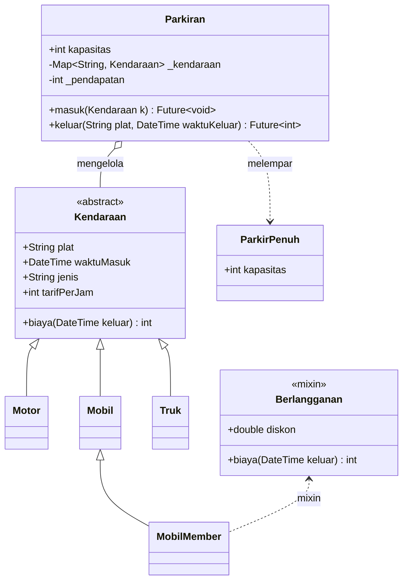
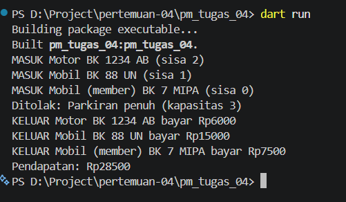

# Tugas Rutin 4: Sistem Parkir Kampus (Console)

## Identitas

- **Nama:** Jhon Gabriel Simarmata
- **NIM:** 4243550020
- **Kelas:** PSIK 24C
- **Mata Kuliah:** Pemrograman Mobile (3KOM40215) Pertemuan 4
- **Dosen:** Adidtya Perdana, S.T., M.Kom

## Diagram Kelas

## Tangkapan Layar Keluaran

## Penjelasan Konsep

Enkapsulasi diterapkan pada `Parkiran` melalui field privat `_kendaraan` dan `_pendapatan`. Kode pemakai tidak mengubah isi kendaraan maupun pendapatan secara langsung; jumlah tempat tersedia dibaca lewat getter `sisa`, sedangkan jumlah uang terkumpul dibaca lewat getter `pendapatan`. Polimorfisme terlihat pada `List<Kendaraan>` yang menampung motor, mobil, mobil member, dan truk. Setiap subclass menyediakan jenis dan tarifnya, sementara mixin `Berlangganan` mengubah label member serta meng-override perhitungan `biaya` untuk memberi diskon 50 persen. Dengan demikian, parkiran dapat memanggil perilaku objek lewat tipe umum `Kendaraan`. Pemrosesan asinkron dipakai oleh `masuk` dan `keluar`, yang menunggu `Future.delayed` untuk mensimulasikan palang parkir. Kejadian masuk dan keluar disiarkan melalui `StreamController.broadcast`, sehingga listener dapat menerima log tanpa menghentikan alur utama. Saat kapasitas habis, `ParkirPenuh` dilempar dan ditangani oleh pemanggil.

## Pernyataan Penggunaan AI

Kode dibuat dengan bantuan AI dan sudah dipelajari serta dijalankan oleh saya.
